# Laser-Cut Fresnel Spotlight

*The Whats-That-Over-There-Inator 5000*

A handheld 1.6 Mcd, 2,000-lumen spotlight built around a Luminus SFT-42R and a 200 mm Fresnel lens, with a laser-cut MDF body and a Seeeduino Nano acting as a 3S battery management system.

**1st place, Machine Made category – BudgetLightForum 13th Annual Old Lumens Contest (2025)**
Build thread: [Ruckusmattster's 13th Old Lumens Entry – Machine Made](https://budgetlightforum.com/t/ruckusmattsters-13th-old-lumens-entry-machine-made/231315)

  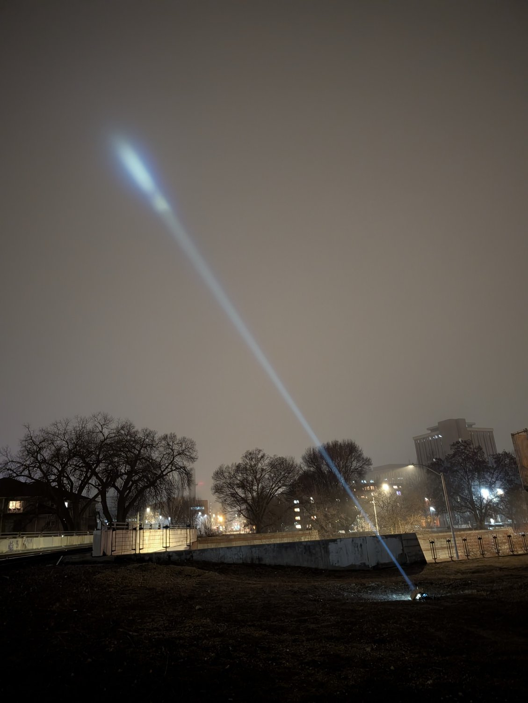
  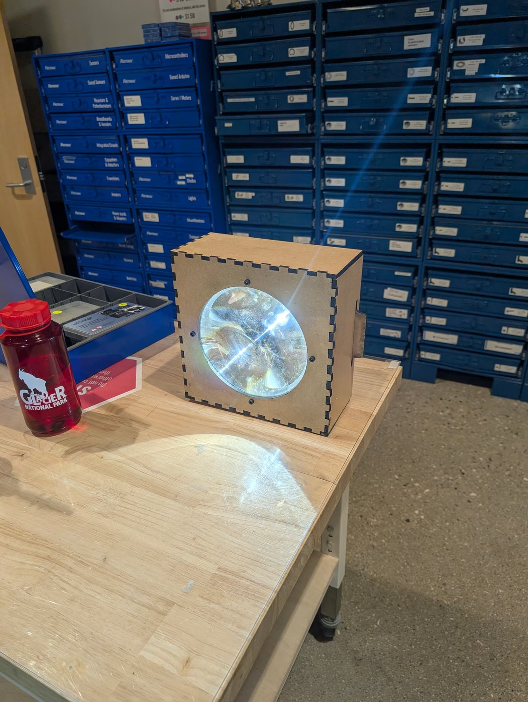

---

## Specifications

| | |
|---|---|
| Peak intensity | 1.6 Mcd (≈2.5 km ANSI FL1 throw) |
| Output | ~2,000 lumens |
| LED | Luminus SFT-42R, 6500 K, on a Convoy 5050 copper board |
| Optic | 200 mm diameter Fresnel lens, 70 mm focal length |
| Drive current | 8.5 A constant current (~60% of the LED's potential) |
| Battery | 3S1P Samsung 50E 21700 |
| Protection | Seeeduino Nano per-cell monitoring (3.00–4.25 V), switching the pack through an automotive relay |
| Cooling | Tower CPU air cooler |
| Body | 1/4" laser-cut MDF, 150 W CO₂ laser |
| CAD | Fully parametric [Onshape model](https://cad.onshape.com/documents/a23385b9adb766b754b1b610/w/0b6a776e412e99eb4f12a709/e/05142f55964d5ccf33e2bbdd) |

> The 1.6 Mcd reading was taken before the LED was properly focused, so the focused value may be higher.

---

## How it works

### Optics
The SFT-42R sits at the focal point of the Fresnel lens, so the lens collimates it into a tight beam. Focus is extremely sensitive: moving the LED just 1.6 mm visibly changes the beam from collimated to converging-then-diverging. Laser-cut centering rings locate both the LED and the lens, which removes the guesswork from alignment during assembly.

Details and the thin-lens maths: [docs/optics.md](docs/optics.md)

### Power path
1. The Seeeduino Nano measures every cell voltage in the 3S pack through resistor dividers.
2. When the power switch is on **and** every cell is between 3.00 V and 4.25 V, the Nano turns on a MOSFET.
3. The MOSFET energises the coil of a JD1912 automotive relay (with a flyback diode).
4. The relay connects the pack to a CC/CV buck-boost module set to 8.5 A with a 3.5 V ceiling, which drives the LED.

The Nano runs from its own separate 9 V battery.

Details: [docs/electronics.md](docs/electronics.md) · Firmware: [firmware/](firmware)

  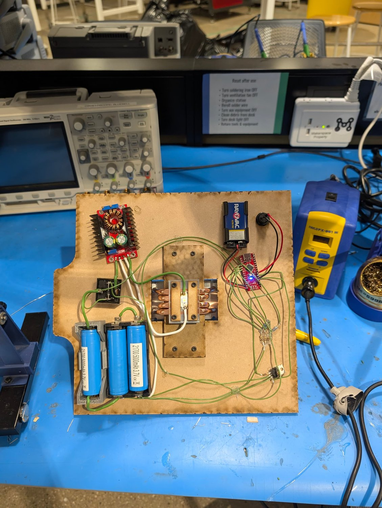

### Enclosure
- Entire body cut from 1/4" MDF on a 150 W CO₂ laser, joined with finger joints.
- Every dimension in the Onshape model is driven by variables, so you can rescale it for a different lens diameter, focal length, PCB thickness or material thickness.
- All electronics mount to one back panel, so everything can be removed and tested with nothing in the way.
- Interior faces are painted black to reduce beam artifacts. Exterior faces are sanded and sealed with a water-based finish, and the front text is laser-engraved.
- The CPU cooler sticks out far enough that the light stands unsupported, either horizontally or pointed at the sky.

---

## Build it yourself

1. Copy the [Onshape document](https://cad.onshape.com/documents/a23385b9adb766b754b1b610/w/0b6a776e412e99eb4f12a709/e/05142f55964d5ccf33e2bbdd) and set the variables to match your lens, material and cooler.
2. Use the **calculated offset** variable to handle the hard-to-calculate adjustments. The model assumes the same CPU cooler, so a different cooler needs this offset changed.
3. Export the flat parts and laser cut them. A laser-cut drilling jig marks the heatsink mounting holes.
4. Assemble the LED mount: a 1/16" PETG centering ring plus two laser-cut MDF pieces clamp the LED to the cooler with thermal paste. The heatsink screws go into a wooden block that bolts to the back panel.
5. Wire the electronics on the back panel (see [docs/electronics.md](docs/electronics.md)) and flash [`firmware/bms/bms.ino`](firmware/bms/bms.ino).
6. Focus by adjusting the LED-to-lens spacing with shims. Check it in a dark room, ideally with fog or haze.

Full parts list: [BOM.md](BOM.md)

The electronics aren't specific to this build. Any way you choose to drive the LED will work.

  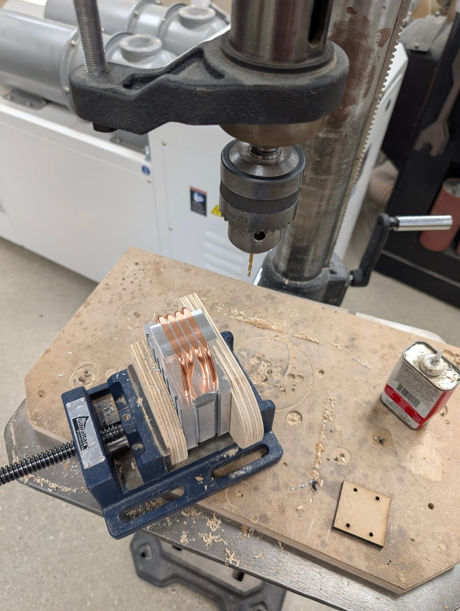
  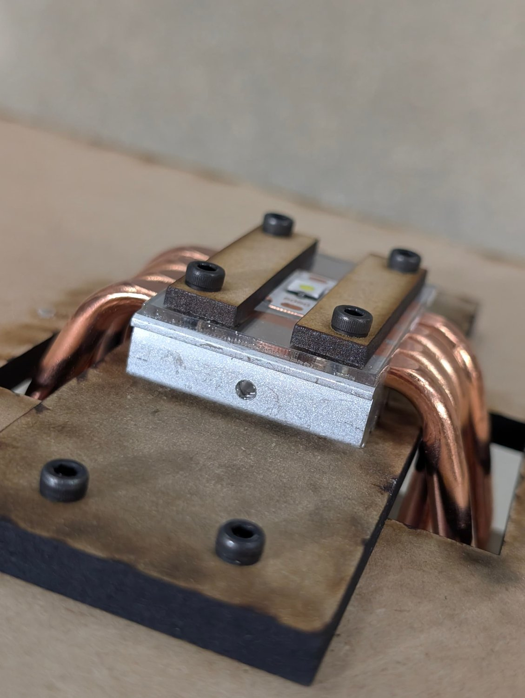
  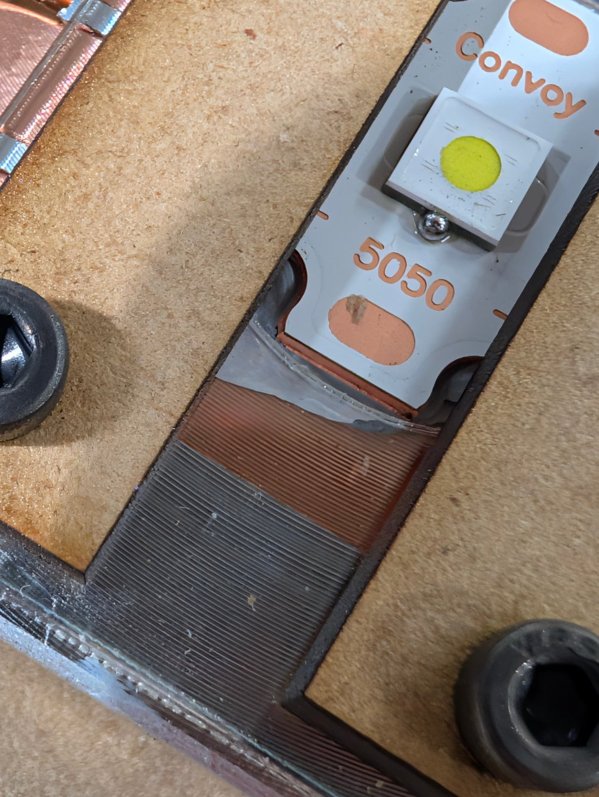

  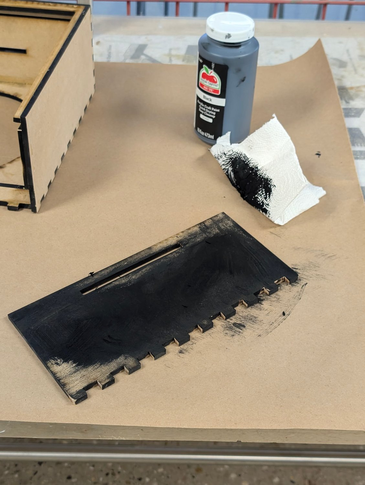
  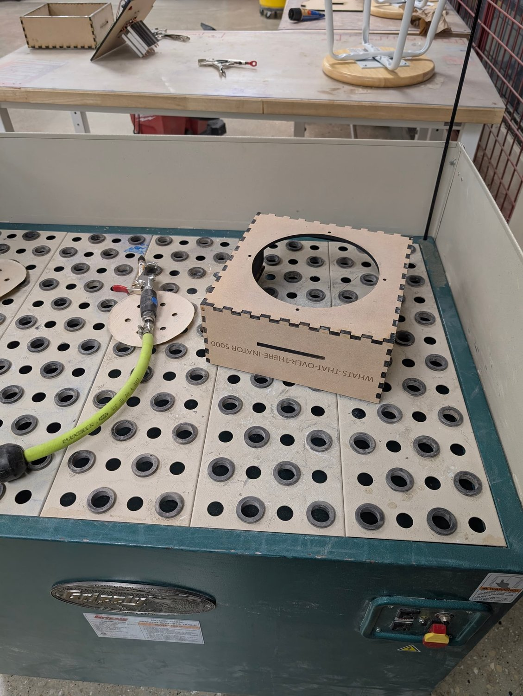

---

## Lessons learned and future improvements
- **Driver current.** The buck-boost module tops out at 8.5 A, which leaves the SFT-42R at about 60% brightness. The target is around 13 A, with a module rated for 15 A.
- **LED mount.** Two 1/8" MDF pieces are probably the main source of beam artifacts. Sheet metal would be better.
- **Assembly access.** There's very little room to hold the nuts that mount the heatsink. Tapped holes in the heatsink would fix this.
- **Focus adjustment.** Shimming works, but you need very thin shims to get it exact. A planned alternative: a spring-tensioned screw through a threaded hole in the heatsink sets the position, then screws through slots perpendicular to the lens lock it in place.
- **Optical losses.** Next step is measuring lens losses cheaply by heating an insulated metal target and comparing thermocouple readings with and without the lens.

---

## Beamshots

  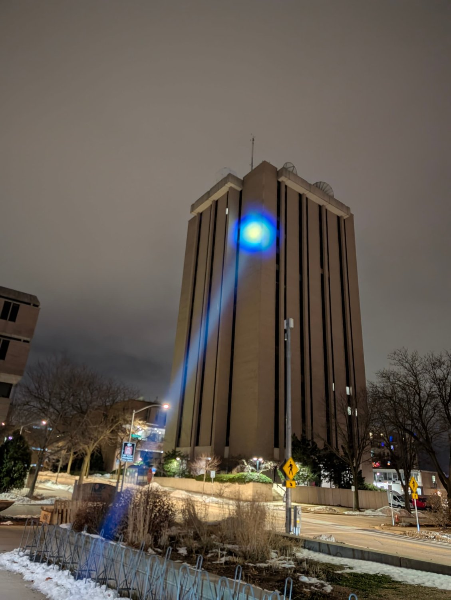
  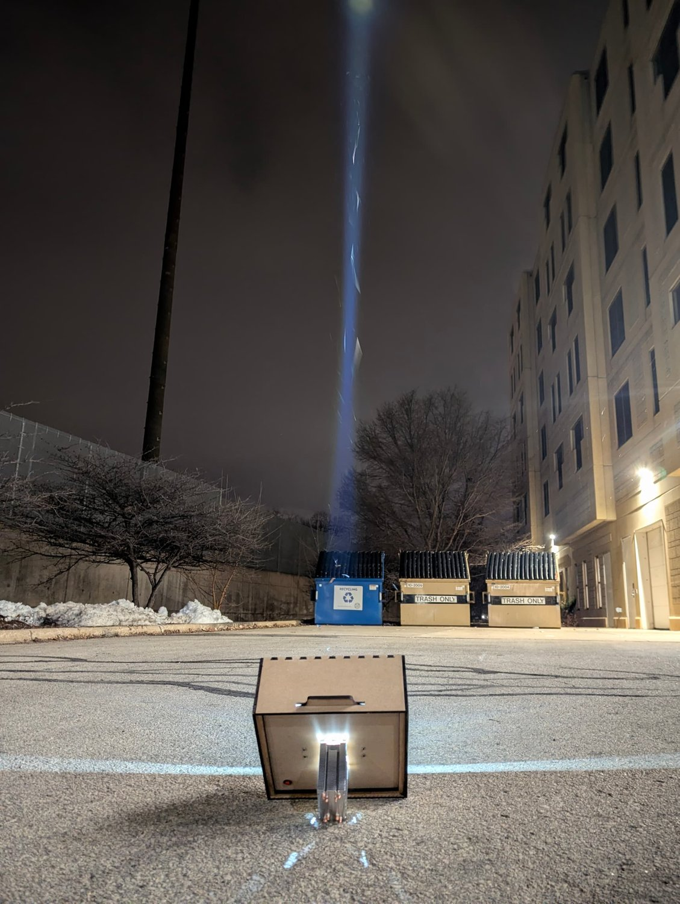
  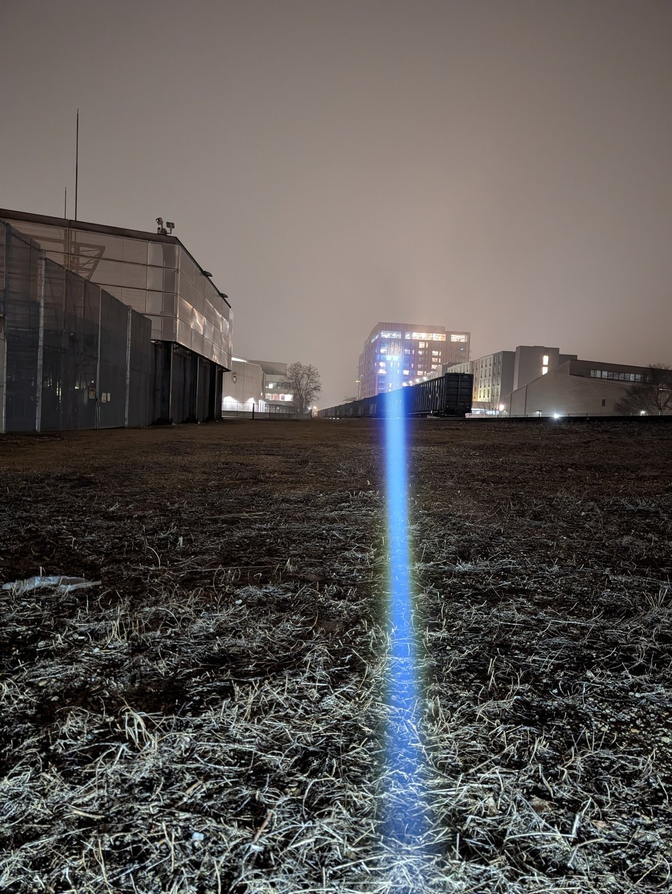

---

## Credits
- A friend from the Badger Solar Racing team guided the BMS design, donated the cells, cell holder and relay, and helped characterise the cells.
- The BMS code was drafted with ChatGPT and reviewed by both of us.
- Thanks to the BudgetLightForum community for feedback in the build thread.
