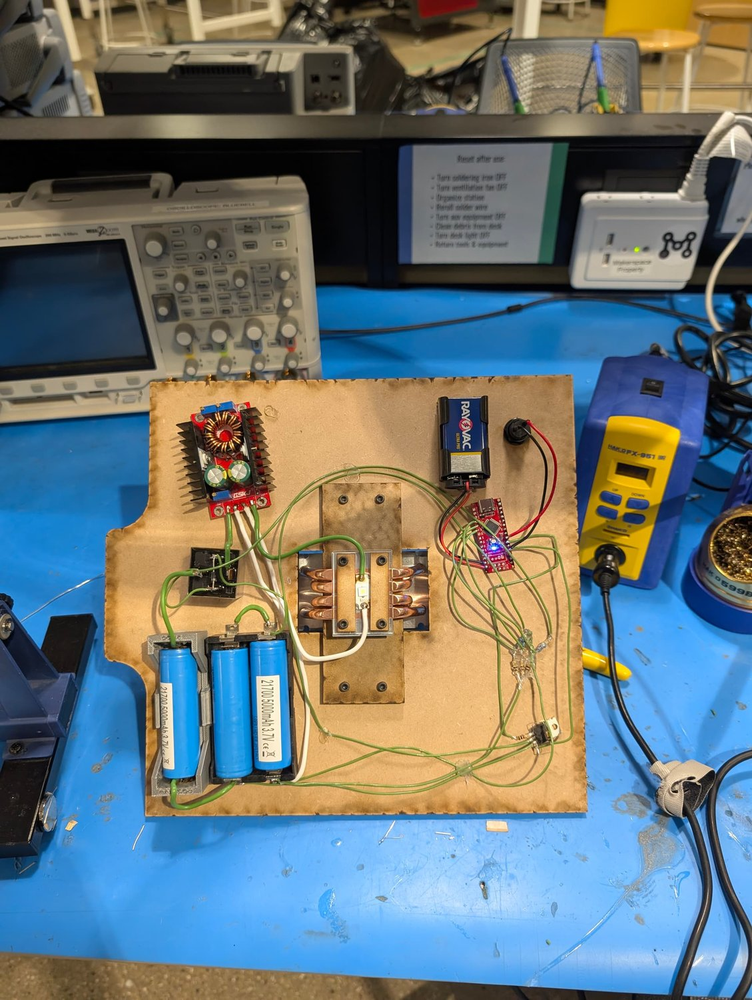
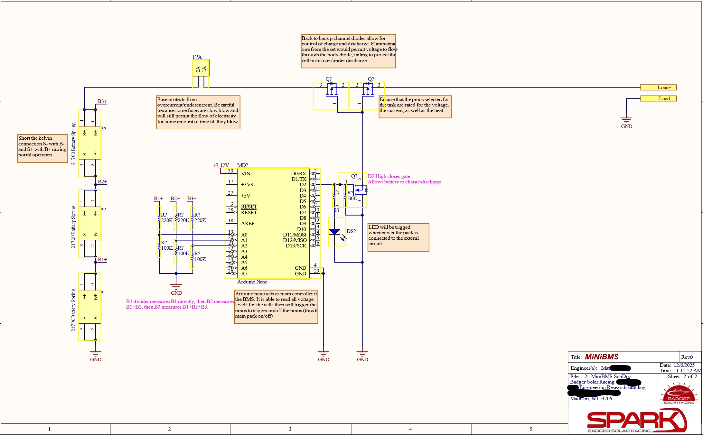

# Electronics



## Overview

```
3S 50E pack ──► JD1912 relay ──► CC/CV buck-boost (8.5 A, 3.5 V max) ──► SFT-42R
                    ▲
          MOSFET on D3 (relay coil, flyback diode)
                    ▲
Seeeduino Nano (own 9 V battery) ◄── 220k/100k dividers on A0, A1, A2 (B1+, B2+, B3+)
                    ▲
             power switch on D4
```

## Schematic



This is the MiniBMS reference design, drawn with a member of the Badger Solar Racing team. The cell-sensing half was built as drawn. The switching half was changed to use parts that were on hand:

| | Schematic | As built |
|---|---|---|
| Cell sensing | 220 kΩ / 100 kΩ dividers on A0–A2 | Same |
| Controller | Arduino Nano, 7–12 V on VIN | Seeeduino Nano, 9 V battery on VIN |
| Pack switch | Back-to-back P-channel MOSFETs (block current in both directions), gate pulled by an N-channel MOSFET on D2 | JD1912 automotive relay, coil switched by a MOSFET on D3, with a flyback diode |
| User control | None, always on when the cells are healthy | Power switch on D4 |

## Battery management
- The Nano reads the three cell taps through 220 kΩ / 100 kΩ dividers and works out each cell's voltage from the difference between adjacent taps.
- The relay only closes when the power switch is on **and** every cell is between **3.00 V and 4.25 V**. The Nano re-checks every 200 ms.
- The relay is held off at power-up, so the pack stays disconnected until the first check passes.
- The Nano runs from its own separate 9 V battery, so it keeps monitoring independently of the main pack.
- Voltages and relay state are logged over serial at 115200 baud, which makes the pack easy to check on the bench.

Firmware, pinout and settings: [`/firmware`](../firmware)

## Driver
- Off-the-shelf CC/CV buck-boost module, set to 8.5 A constant current with a 3.5 V voltage limit.
- It runs warm but doesn't overheat.
- Its 8.5 A maximum leaves the SFT-42R at about 60% brightness. A driver capable of about 13 A is the planned upgrade. A 20 mm Convoy-style buck driver was considered, but ruled out because of uncertainty about how it would handle the heat.

## Mounting
All electronics mount on the back panel, so the whole system can be removed and tested without taking the light apart.
